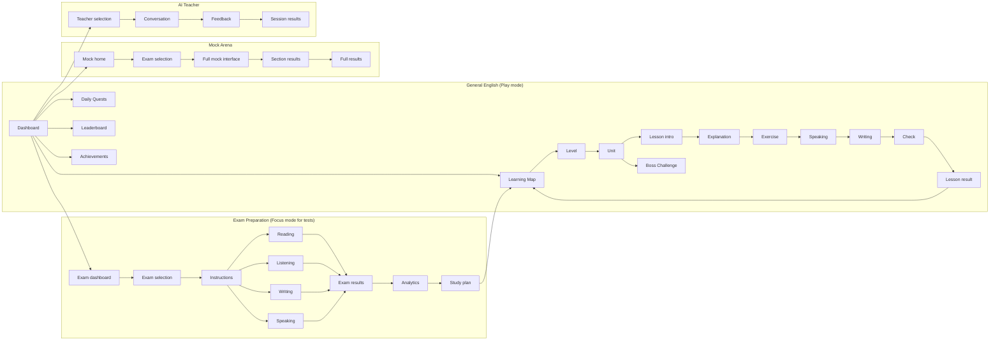

# Bandly Screen Wireframes

Status: **low-fidelity wireframes for owner review.** Not final visual design.
The owner-approved reference images are in `design-references/` (see its README for what is taken and what is avoided).
Visual rules come from `BANDLY_DESIGN_SYSTEM.md`, mechanics from `GAMIFIED_LEARNING_SPEC.md`, exam rules from `REAL_EXAM_EXPERIENCE_SPEC.md`, and teachers from `AI_TEACHER_CHARACTER_SPEC.md`.

**How to read a screen card:**
- **Purpose.** What the screen is for.
- **Desktop / Mobile.** An ASCII sketch of each layout.
- **Components.** What the screen is built from.
- **Navigation.** Where the screen is reached from and where it leads.
- **Interactions.** What the learner can do.
- **States.** Loading (L), Empty (E), Error (Er), Success (S).
- **A11y.** Accessibility requirements.
- **AC.** Acceptance criteria.

Status of each screen today:
- **[EXISTS]**: route and screen exist.
- **[PARTIAL]**: exists in another form.
- **[NEW]**: not built yet.

**Global rules for every screen:**
- Mobile is designed first, at 360 × 740 px.
- No horizontal scroll.
- Touch targets ≥ 44 px.
- Exactly one primary action per screen.
- All strings come from i18n.
- Focus mode on exam screens (no Header, no TabBar).

---

## 0. Navigation maps

Mobile TabBar (5 tabs, already shipped): **Bosh sahifa · Darslar (Map) · AI Ustoz · Imtihon · Profil**. Mock Arena and Games are reached from the Dashboard and Exam.

---

# A. General English

### A1. Dashboard **[PARTIAL]** (`Home.tsx` + `PlanCard`)
**Purpose:** answer "what do I do now?" in one glance.
```
Desktop                                                   Mobile
┌───────────────┬──────────────────────────┬───────────┐  ┌────────────────────────┐
│ Sidebar       │ Salom, Aziz! 🔥 12  ⭐ L7  │ League    │  │ Bandly    🔥12  ⭐L7  ☰  │
│ Map           │ ┌──────────────────────┐ │ Gold #4   │  │ ┌────────────────────┐ │
│ Teacher       │ │ Bugungi reja 25 daq  │ │───────────│  │ │ Ustoz: "Bugun 3 ta │ │
│ Exam          │ │ ▸ Dars: Past simple  │ │ Quests 1/3│  │ │ vazifa. Ketdik!"   │ │
│ Mocks         │ │ ▸ 3 ta xato takrori  │ │ ▸ 2 dars  │  │ └────────────────────┘ │
│ Games         │ │ [ Davom ettirish ▶ ] │ │ ▸ 3 xato  │  │ [ ▶ Davom ettirish   ] │
│ Profile       │ └──────────────────────┘ │ ▸ 5 so'z  │  │ Reja: 3 vazifa ▸       │
│               │ Week streak ●●●●○●●      │           │  │ Quests 1/3 ▸ League ▸ │
└───────────────┴──────────────────────────┴───────────┘  └────────────────────────┘
```
- **Components:** greeting with stats (streak, player level, CEFR level), teacher tip (small portrait), Plan card [EXISTS], quests card, league mini-card, week strip.
- **Navigation:** "Davom ettirish" opens the next plan task. The cards open Quests, League and Map.
- **States:**
  - L: skeleton cards.
  - E (no level): one card "Darajangizni aniqlang" with a teacher welcome.
  - Er: the plan cannot be built → show the Map link.
  - S: everything done → "Bugungi maqsad bajarildi" plus an optional game.
- **A11y:** the stats have text labels ("12 kunlik seriya"). The primary CTA is first in the tab order.
- **AC:**
  - The primary CTA is visible without scrolling at 360 × 740.
  - Every number comes from real data. No placeholder stats.

### A2. Learning Map **[NEW]** (replaces the list view in `Learn.tsx`)
**Purpose:** see the whole A1–C2 path and the current position.
```
Mobile                                   Desktop: map on the left (scroll), right panel = node details + plan
┌────────────────────────┐
│ B1 · Intermediate  ▾   │ ← sticky level header (level colour)
│        ( ✓ )           │
│     ( ✓ )              │   path line fills as lessons pass
│          ( ● ) ← you   │   pulse ring on the current node
│     ( 🔒 )             │
│        [👑 BOSS]       │
│ ── Milestone: B1 check │
│ [ ▶ Davom ettirish ]   │ ← FAB
└────────────────────────┘
```
- **Components:** level header, nodes (lesson, challenge, boss, milestone), path, a node bottom sheet (objective, minutes, XP, best score, Start), "pilot" chip.
- **Interactions:**
  - Tap a node to open its sheet.
  - Long-press a locked node to see why it is locked.
  - The level switcher jumps between levels.
- **States:**
  - L: skeleton path.
  - E: no placement → a single CTA.
  - Er: the content failed to load → retry.
  - S: a node unlock animation.
- **A11y:**
  - The map is also exposed as an ordered list (each node is a button with its state: "3-dars, tugallangan").
  - Path animation is off under reduced motion.
- **AC:**
  - Node states equal `isUnlocked()` and the progress store.
  - 42 nodes render in < 300 ms.
  - The current node is in view on open.

### A3. Level screen **[NEW]**
**Purpose:** a level overview (A1…C2): goals, units, progress and the checkpoint.
```
┌────────────────────────┐
│ ← A2 Elementary        │
│ "Kundalik vaziyatlar…" │  CEFR goal summary (pilot, needs review)
│ ▰▰▰▰▱▱ 4/9 dars        │
│ Unit 1 Last weekend ✓  │
│ Unit 2 In the city ●   │
│ Unit 3 Health… 🔒      │
│ [ A2 checkpoint test ] │
└────────────────────────┘
```
- **Components:** level hero (level colour), goal text, units list with progress, checkpoint CTA.
- **States:** E (level assumed by placement) → banner "Bu daraja o‘tilgan deb hisoblandi — mashq qilish ixtiyoriy".
- **AC:** progress counts equal the passed lessons in the level.

### A4. Unit screen **[NEW]**
**Purpose:** a unit with its real-life situation, lessons, challenge and boss.
```
┌────────────────────────┐
│ ← A2 · In the city     │
│ [illustration: city]   │
│ Situatsiya: yo‘l so‘rash│
│ 1 There is/are   ✓ 92% │
│ 2 Prepositions   ● 40% │
│ 3 How much/many  🔒    │
│ ⚡ Challenge: Word rush │
│ 👑 Boss (12 savol) 🔒  │
└────────────────────────┘
```
- **Components:** unit header with `situationUz`, lesson rows with best score, challenge row, boss row.
- **Navigation:** a lesson row opens the Lesson intro.
- **States:** the boss is locked until all lessons pass (or as decided by PXD-05).
- **AC:** the best score equals the stored attempt.

### A5. Lesson introduction **[PARTIAL]** (the `Lesson.tsx` header)
**Purpose:** set expectations before starting.
```
┌────────────────────────┐
│ ✕                      │
│ [teacher bust: happy]  │
│ "Bugun: Past simple"   │
│ Maqsad: o‘tgan ish-     │
│ harakatni aytish        │
│ ⏱ ~12 daq · ⭐ 60 XP    │
│ ❤ 5 · 5 qadam          │
│ [   Boshlash ▶   ]     │
└────────────────────────┘
```
- **Components:** teacher (voice line optional), objective, time, XP, hearts info, the 5-step preview.
- **States:** pilot chip. Er: lesson not found → back to the Map.
- **AC:** the objective is the lesson's `objective` field; the minutes come from content.

### A6. Lesson explanation (Step 1 Tushuntirish) **[EXISTS → game layer]**
```
┌────────────────────────┐
│ ✕ ▰▱▱▱▱      ❤5  🔥0   │ ← lesson header replaces the nav
│ [teacher mini] "Qoida:"│
│ I/You/We + worked      │ form table
│ ┌ Example 🔊 ┐         │ pre-made US audio (Hope/Max)
│ │ I worked yesterday.  │
│ └──────────────────────┘
│ Tap to reveal: "go → ?"│ 1–2 quick checks, no hearts
│ [   Tushundim ▶   ]    │
└────────────────────────┘
```
- **A11y:** examples marked `lang="en"`; audio buttons labelled "Eshitish: …".
- **AC:** every example plays its pre-made clip, with a browser-voice fallback.

### A7. Exercise (Step 2 Mashq) **[EXISTS → game layer]**
```
┌────────────────────────┐
│ ✕ ▰▰▱▱▱      ❤4  🔥3   │
│ Gapni to‘ldiring:       │
│ She ____ to school.    │
│ [  go  ] [ goes ]      │ ← 56 px answer cards
│ [ going] [ gone ]      │
│                        │
│ [  Tekshirish  ]       │
├────────────────────────┤ feedback sheet (after check)
│ ✔ To‘g‘ri! +12 XP  ×3  │ or ✖ "goes" — 3-shaxs -s  [Davom]
└────────────────────────┘
```
- **Components:** item renderer (choice / gap / order) [EXISTS `LessonItem`], answer cards, check button, feedback sheet, teacher reaction (mini portrait + optional voice).
- **Interactions:**
  - Select an answer, then Check.
  - Keyboard: keys 1–4 select, Enter checks.
  - "Bilmayman" skips the item (keeps the combo, gives 0 XP).
- **States:**
  - Er: the TTS reaction failed → silent text reaction.
  - Hearts at 0 → the re-learn flow (GAMIFIED §3.2).
- **AC:**
  - Feedback appears in < 100 ms (local grading).
  - XP follows the GAMIFIED §3.1 rules.

### A8. Speaking (Step 3 Gapirish) **[EXISTS → game layer]**
```
┌────────────────────────┐
│ ✕ ▰▰▰▱▱      ❤4  🔥3   │
│ Ayting: 🔊             │
│ "I visited my aunt."   │
│ [teacher: listening]   │
│     (  ● 88px  )       │ mic button with level ring
│ You said: "I visit…"   │ live transcript (browser STT)
│ Match: 4/5 words ✓     │
└────────────────────────┘
```
- **States:**
  - Mic denied → instructions plus the "matn bilan" fallback.
  - STT unsupported → listen-and-repeat only.
- **Honesty:** no pronunciation score is shown until an assessment provider exists (OD-21).
- **AC:** never blocks lesson progress, whatever the mic outcome.

### A9. Writing (Step 4 Yozish) **[EXISTS → game layer]**
```
┌────────────────────────┐
│ ✕ ▰▰▰▰▱                │
│ Mission: 40–60 so‘z     │
│ "Yesterday I …"        │
│ ┌────────────────────┐ │
│ │ text area          │ │
│ └────────────────────┘ │
│ 42 so‘z · ✓ past simple│ live rule hints
│ [  Tekshirish  ]       │
└────────────────────────┘
```
- **AC:** the rule check equals `checkWriting()`; the model answer is shown after the attempt.

### A10. Lesson result **[PARTIAL]**
```
┌────────────────────────┐
│ [teacher: happy/laugh] │
│ 90% ✓ Dars tugadi!     │
│ +62 XP  🔥 combo max 7 │
│ Mastery: Past simple    │
│ 54% → 71%  ▰▰▰▰▰▱▱     │
│ Xatolar: 2 (takrorga)  │
│ [ Keyingi dars ▶ ]     │
│ Xaritaga qaytish       │
└────────────────────────┘
```
- **States:**
  - Fail (< 80 %): a "what to fix" list plus "Qayta urinish" and the re-learn option; no XP for the pass bonus.
  - S: confetti once.
- **AC:** the mastery delta comes from the engine, before and after values.

### A11. Boss Challenge **[NEW]**
```
┌────────────────────────┐   intro → 12–15 items (same item UI, ❤3) → result
│ 👑 Unit boss           │
│ [teacher: serious]     │
│ 12 savol · 30% takror  │
│ ❤ 3                    │
│ [   Jangni boshlash ]  │
└────────────────────────┘
```
- **Result screen:** score, missed items with explanations, per-node mastery, a badge on the first win, and "Keyingi unit".
- **States:** abandoned → resume within 24 h.
- **AC:** see GAMIFIED §3.5.

### A12. Daily Quests **[NEW]**
```
┌────────────────────────┐
│ Bugungi vazifalar  1/3 │
│ ☑ 2 ta dars    +20 XP  │
│ ☐ 3 ta xatoni tuzat ▸  │
│ ☐ 5 yangi so‘z       ▸ │
│ 🎁 Hammasi → sandiq    │
└────────────────────────┘
```
- **States:** E: all done → a teacher line plus tomorrow's preview.
- **AC:** each quest links directly to the task that completes it.

### A13. Leaderboard / League **[PARTIAL]** (`League.tsx`)
```
┌────────────────────────┐
│ Gold liga · 3 kun qoldi│
│ ▲ Promotion zone (1–7) │
│ 1 Nodir      1 240 XP  │
│ 4 Siz (Aziz)   980 XP  │ highlighted row
│ ▼ Relegation (26–30)   │
│ "sinov" chip until XP  │
│ is server-verified     │
└────────────────────────┘
```
- **States:**
  - E: not enough active players → "Liga tez orada".
  - Er: the server is down → cached list with a timestamp.
- **AC:** only nicknames are shown; the opt-out works.

### A14. Achievements **[PARTIAL]** (8 exist in `game.ts`)
```
┌────────────────────────┐
│ Yutuqlar 6/20          │
│ [🏅][🏅][🏅][🔒][🔒]   │ grid, 3–4 per row
│ 🔒 "Bossni yeng" — 1-unit│ requirement shown
└────────────────────────┘
```
- **AC:** each badge shows its unlock rule; unlocks are deterministic.

---

# B. Exam Preparation

### B1. Exam dashboard **[PARTIAL]** (`Exam.tsx` tabs IELTS / CEFR / SAT)
```
┌────────────────────────┐
│ Imtihon: IELTS ▾        │
│ Maqsad 6.5 · 42 kun    │
│ Tayyorlik: Reading 6.0 │ ReadinessCard [EXISTS], labelled "taxminiy"
│ [ Full mock ▶ ]        │
│ Mashq: R · L · W · S   │
│ Natijalar tarixi ▸     │
└────────────────────────┘
```
- **AC:** the readiness numbers come only from real attempts; with no attempts the card says "Hali natija yo‘q".

### B2. Exam selection **[PARTIAL]**
- A card per exam: **IELTS Academic · IELTS General · CEFR Multilevel · SAT**, each with its verified format summary (from `examFormats.ts`) and a free/premium tag.
- **States:** an exam with no full-mock content shows "Mashq mavjud, to‘liq mock tez orada" (honest).
- **AC:** every format number has a source.

### B3. Exam instructions **[NEW]**
```
┌──────────────────────────────────────────┐  Focus mode starts here
│ IELTS Listening — Ko‘rsatmalar           │
│ • 4 qism, 40 savol, ~30 daqiqa            │
│ • Audio faqat BIR marta eshittiriladi     │
│ • Oxirida 2 daqiqa tekshirish vaqti       │
│ [ 🔊 Ovozni tekshirish ]  ✓ eshitildi     │
│ [        Imtihonni boshlash        ]      │
└──────────────────────────────────────────┘
```
- **AC:** the "start" button is disabled until the audio check has played (Listening), with an option to skip and acknowledge.

### B4–B7. Reading · Listening · Writing · Speaking
These use the exam interfaces in `REAL_EXAM_EXPERIENCE_SPEC.md` §5.1–5.5 (desktop and mobile ASCII). Shared states:
- **L:** a "Savollar yuklanmoqda" skeleton; the timer does not start until the content is ready.
- **Er:**
  - Audio failed → "Audio yuklanmadi" plus retry; the timer is paused only for that reason, and the event is logged.
  - Connection lost → banner plus local saving (E1).
- **S:** a section-completed screen with time used and answered/flagged counts.
- **A11y:** keyboard navigation, question announcements, timer announced at 10 / 5 / 1 min only.
- **AC:** the reliability tests in REAL_EXAM §6.

### B8. Exam results **[PARTIAL]** (`Results.tsx`)
```
┌────────────────────────┐
│ IELTS mock · 15-noyabr │
│ Overall ≈ 6.0 (taxminiy)│
│ L 6.5  R 6.0  W —  S — │ W/S "AI baholash mavjud emas" if off
│ To‘g‘ri: L 27/40 R 24/40│
│ Vaqt: L 31:20 R 58:02  │
│ [ Batafsil tahlil ▸ ]   │
└────────────────────────┘
```
- **AC:** estimates are always labelled; no band is shown for unscored sections.

### B9. Detailed analytics **[NEW]**
- Per question type (T/F/NG, matching, gap…): accuracy and time.
- Per taxonomy id (`R.inference`, `L.distractor`…).
- Previous attempts as a line chart (`LineChart`) with a text summary.
- Answer review: question, the learner's answer, the correct answer, an explanation (shown after submit only).
- **AC:** every chart has a table alternative.

### B10. Personalised study plan **[PARTIAL]** (`PlanCard`, `dailyPlan.ts`)
- From the analytics: "Haftalik reja": weak types become practice sets plus General English lessons, with the days until the exam.
- **AC:** the plan items link to real content; the reason text comes from `whyUz()`.

---

# C. Mock Arena

### C1. Mock home **[PARTIAL]** (`Mocks.tsx`)
```
┌────────────────────────┐
│ Mock Arena  BEPUL       │
│ ▸ IELTS full mock (L+R) │ free objective
│ ▸ Mini testlar (11)     │
│ ▸ CEFR / SAT — tez orada│
│ Davom ettirish: L 12/40 │ resume banner
└────────────────────────┘
```

### C2. Exam selection
Same as B2, filtered to mock-capable exams.

### C3. Full mock interface
REAL_EXAM §4–§5, in Focus mode, section-to-section without results in between.

### C4. Section results
Time used, answered/flagged counts. **No score** until the full mock ends (realism toggle for practice: "natijani darhol ko‘rsatish" is off by default).

### C5. Full mock results
As B8, plus a share card (score image without personal data, optional).

### C6. Free / premium boundaries
```
┌────────────────────────┐
│ Writing (AI baholash)  │
│ 🔒 Exam / All Access   │
│ Qoldi: 7/10 shu oy     │ from plan limits (AI_COST_CONTROL_SPEC)
│ [ Tariflar ▸ ]          │
└────────────────────────┘
```
- **AC:**
  - Objective sections are never behind a paywall (DR-19). The conflict with today's gated `#/mocks/full` is PXD-09.
  - Counters show the real remaining units.

---

# D. AI Teacher

### D1. Teacher selection **[PARTIAL]** (`PersonaPicker`)
```
┌────────────────────────┐
│ Ustozingizni tanlang   │
│ [ Ustoz M ] [ Ustoz F ] │ busts, neutral; tap = preview line (cached audio)
│ Uslub: Mehribon ▾       │ 5 personas; Savage 🔒 18+ (OD-06b)
│ Til: O‘zbek + English   │
│ [   Suhbatni boshlash ] │
│ Qolgan: 42 daq / 60    │ live minutes (plan)
└────────────────────────┘
```

### D2. Conversation screen **[PARTIAL]** (`Coach.tsx`)
See the mobile sketch in AI_TEACHER §6.
- **Components:** teacher bust with an emotion ring, subtitles, mic button, mute, text input toggle, minutes counter, end button.
- **States:**
  - Thinking (≤ 3 s target).
  - Listening.
  - Speaking.
  - Er: AI off → "AI ustoz hozircha mavjud emas", with offline practice suggestions (honest, fail-closed).
  - Minutes exhausted → summary plus extra-minute pack info (AI_CREDIT_TOPUP_SPEC).

### D3. Character states
The 8 emotions + neutral are rendered per AI_TEACHER §3; the transitions follow §4.

### D4. Voice controls
Mute, replay last line, speed (0.9 / 1.0), subtitles on/off, text-only mode, choice of US/UK model voice.

### D5. Feedback (in-conversation)
```
│ ✖ «I go yesterday» → ✔ I went yesterday   🔊 │  correction chip under the teacher line
│   Sabab: o‘tgan zamon (G.tense)               │  taxonomy id, saved to mistakes
```

### D6. Session results
Minutes used, corrections list (saved to Mistakes), new words, persona used, next suggestion.
- **AC:** every correction is in `mistakes.ts`; minutes come from provider-reported usage.

---

## E. Cross-screen acceptance checklist
1. 360 px: no horizontal scroll; the primary action is visible; text ≥ 16 px.
2. Dark mode passes contrast on every screen.
3. Every screen has the L / E / Er / S states implemented and covered by a Playwright screenshot test.
4. Exam screens contain no gamification or teacher animation (automated DOM test).
5. Every number on screen comes from real data or is labelled an estimate.
