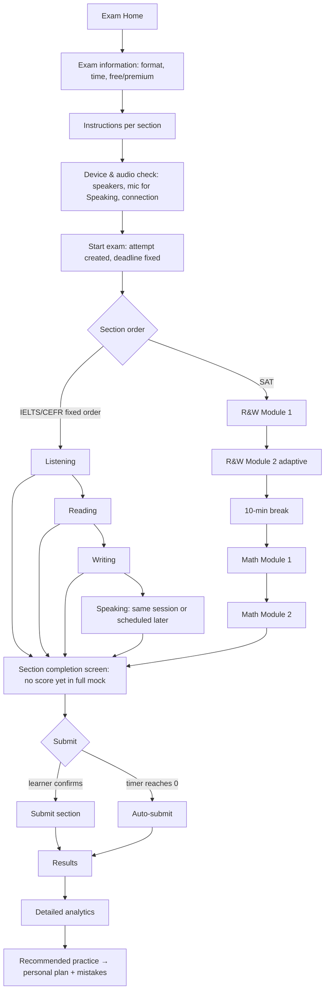

# Real Exam Experience Spec

Status: **design for owner review. No code yet.** This spec supersedes nothing. It details `master-spec-v2/EXAM_PREPARATION_SPEC.md` and `MOCK_ARENA_SPEC.md`.

Labels used throughout:
- **[EXISTS]**, **[PARTIAL]**, **[NEW]**: implementation status.
- **[F]**: verified official format fact, with its source.
- **[S]**: confirmed from official-site search results on 2026-11-15; the page itself must be re-read before content production.
- **[U]**: not verified; owner or content decision needed.

**Rule:** exam screens use **Focus mode** (`BANDLY_DESIGN_SYSTEM.md` §1.2). They have no XP pop-ups, hearts, combo, mascot or teacher animation, banners, or global nav.

## 1. What exists today (honest baseline)
| Item | Status | Where / gap |
|---|---|---|
| Reading mini-tests (6), Listening mini-tests (5) | **[EXISTS]** about 15 min / about 10–13 questions (Reading), 8 min (Listening) | `src/content/reading*.ts`, `listening*.ts`, `MockTest.tsx` |
| Countdown with auto-submit at 0 | **[PARTIAL]** | `useCountdown` in `MockTest.tsx`. **Client-only**: answers live in React state and are **lost on reload**; there is no autosave and no server deadline. |
| Band estimate from a raw score table | **[EXISTS]** labelled estimate, capped by level | `scaledBand`, `capBand` |
| "Full exam" page | **[PARTIAL]** | `FullExam.tsx` runs the mini-tests in sequence; it is **not** a full-format mock |
| Listening audio | **[EXISTS]** 5 pre-made tracks (regenerated 2026-11-15 with ElevenLabs, PR #24) | `public/audio/listening` |
| Writing practice + AI evaluation | **[PARTIAL]** | rule checks work; AI evaluation is off (no AI key) |
| Speaking examiner (live, browser STT) | **[PARTIAL]** | `Speaking.tsx`, `Examiner` class; no recording kept; scoring needs AI |
| CEFR tab (verified format, writing practice) and SAT tab (17 original items) | **[PARTIAL]** practice only | `CefrPrep.tsx`, `SatPrep.tsx`, `examFormats.ts` |
| Question navigator, flag for review, highlight, notes, play-once audio, full-screen focus layout | **missing** | — |
| Answer keys | **gap C2**: keys ship in the public JS bundle | `PRODUCT_AUDIT.md` |

## 2. Exam products: official formats
### 2.1 IELTS Academic and IELTS General Training
| Section | Format | Status |
|---|---|---|
| Listening | about **30 min**, **40 questions**, 4 recordings (2 monologues, 2 conversations), played **once**. On paper there are +10 min to transfer answers; on computer there are **2 min to check answers**. | [S] ielts.org Academic and GT pages; IDP Listening guide |
| Reading | **60 min**, **40 questions** | [S] ielts.org |
| Reading text types | Academic: long texts. GT: everyday and workplace texts. | [U] exact passage count and types per module must be read from ielts.org "test format in detail" before content is written |
| Writing | **60 min**. Academic Task 1: describe a graph, table, chart or diagram, **≥ 150 words, about 20 min**. GT Task 1: a letter. Task 2 (both): essay, **≥ 250 words, about 40 min**. | [S] ielts.org Academic format; GT letter word count [U] |
| Speaking | **11–14 min**, 3 parts, face to face. Part 2: a task card, **1 min preparation, up to 2 min talk**, 3–4 min in total, pencil and paper for notes. May be on the same day or up to 7 days from the other sections. | [S] ielts.org Speaking format; Part 1 and Part 3 lengths [U] |
| Order and total | Listening, Reading, Writing in one sitting without breaks. Total **2 h 45 min**. | [S] |
| Computer-delivered tools | Highlight in Reading and Listening (not Writing); flag a question and return to it. Notes: sources conflict (digital notepad vs paper). | [S] IDP pages; notes [U] |
| Scoring | Band scores. Raw-to-band conversion is **not** official in Bandly; the existing tables stay labelled "taxminiy" (estimate). | [U] official conversion not published as a fixed table |

Sources:
- https://ielts.org/take-a-test/test-types/ielts-academic-test
- https://ielts.org/take-a-test/test-types/ielts-general-training-test
- https://ielts.org/take-a-test/test-types/ielts-academic-test/ielts-academic-format-speaking
- https://ielts.org/organisations/ielts-for-organisations/test-types/ielts-academic-test/academic-test-format-in-detail
- https://ielts.idp.com/nepal/about/which-test-do-i-take/ielts-on-computer/how-to-highlight-text

### 2.2 CEFR / Multilevel (Uzbekistan), already verified [F] in `src/content/examFormats.ts`
| Section | Items | Time |
|---|---|---|
| Listening | 35 tasks | 45 min |
| Reading | 35 tasks | 60 min |
| Writing | 2 tasks: 100–150 words and 200–250 words | 60 min |
| Speaking | 3 task types | 15 min |

- **Scoring** on a 75-point scale: C1 65–75, B2 51–64, B1 38–50.
- **Sources:** Cabinet of Ministers decision No. 73 (lex.uz); UzBMB Bulletin 1/2023.
- **Unverified [U]:**
  - internal parts of each section,
  - task types,
  - delivery mode (computer or paper),
  - tool availability (highlight, flag).

  The mock must not imitate a specific official UI that we have not seen.

### 2.3 Digital SAT, already verified [F] (College Board, `DIGITAL_SAT`)
| Section | Format |
|---|---|
| Reading & Writing | 54 questions, 64 min, 2 modules × 32 min |
| Math | 44 questions, 70 min, 2 modules × 35 min |
| Break | 10 min between sections |
| Adaptivity | Module 2 is easier or harder depending on Module 1 |
| Scores | 400–1600; each section 200–800 |

- **[U]:** built-in calculator and reference sheet details, the annotation tool, and "mark for review" behaviour must be read from College Board / Bluebook pages before building.
- **Honesty rule:** Bandly's SAT is "adaptive-style" practice. The score is an **estimate**: we have no calibrated item parameters, so no "official-like" score is claimed (PXD-10).

## 3. Exam flow


| Step | Content | Edge cases |
|---|---|---|
| Exam Home | the exams the learner can take; last attempt; resume banner | an unfinished attempt is offered as "Davom ettirish" |
| Information | duration, sections, "free / premium" boundary (§8), honest note "Bandly mustaqil mashq, rasmiy test emas" | — |
| Instructions | per section, the **official-style rules in plain Uzbek + English**; e.g. "Audio faqat bir marta" | the learner can re-open instructions from the help icon |
| Device check | play a test tone; mic level for Speaking; network ping; recommends desktop or tablet for a full mock (PXD-11) | no mic → Speaking is offered as text-only practice (not as a mock) |
| Start | creates the attempt and fixes the deadline (§6) | double-tap start creates one attempt |
| Sections | auto-advance in the official order; the learner cannot go back to a finished section | — |
| Section completion | "Bo‘lim yakunlandi", time used, answered count, **no score** until the whole mock ends (realism) | — |
| Submit confirmation | lists unanswered and flagged questions; buttons "Qaytish" and "Topshirish" | — |
| Auto-submit | at 0: saves and submits whatever is answered; the screen explains this | the connection was offline at 0 → see §6 |
| Results | estimated band/score per section, overall, correct/incorrect, time per section | — |
| Analytics | per question type and taxonomy id, time per question, vs. previous attempt, readiness (`ReadinessCard`) | — |
| Recommended practice | adds weak skills and mistakes to the plan (`mistakes.ts`, `dailyPlan.ts`) and links General English lessons | — |

## 4. Exam interface components **[NEW]**
| Component | Behaviour |
|---|---|
| **Full-screen layout** | `data-mode="focus"`; Header and TabBar hidden; optional browser fullscreen API on desktop (never forced) |
| **Top bar** | exam and section name · **timer** (mm:ss, tabular digits; turns amber at 10 min and red at 5 min; announced to screen readers at 10/5/1 min) · help · hide-timer toggle (as in computer IELTS) |
| **Question navigator** | bottom strip (desktop) or sheet (mobile) with numbered cells showing answered, unanswered, flagged and current; jump on tap |
| **Flag for review** | per question; listed again on submit confirmation |
| **Highlight** | select text in a Reading passage or a Listening question to highlight it; clear highlight; stored with the attempt (not graded) |
| **Notes** | per-section scratch notes (not graded); this is a design choice where the official mode differs [U] |
| **Previous / Next** | buttons + keyboard (Alt+N, Alt+P) |
| **Autosave** | on every change (debounced 500 ms) + on visibility change; a quiet "Saqlandi ✓" indicator |
| **Section progress** | "Savol 14 / 40" + bar |
| **Audio player (exam)** | starts when the section starts; plays once; no seek or pause; volume only; on the computer variant, a 2-min check time after the audio |
| **Writing editor** | task left / editor right; live word count; no spell-check (`spellcheck="false"`); copy/paste allowed only inside the editor [U]; autosave |
| **Reading passage** | scrollable left pane, highlight; question pane on the right; resizable divider on desktop |
| **Speaking recorder** | examiner question (pre-made UK audio + text), prep timer (Part 2: 60 s), talk timer (up to 2 min), level meter, automatic part transitions |
| **Submit controls** | "Bo‘limni topshirish" with confirmation; disabled while saving |

## 5. Wireframes (desktop and mobile per skill)
### 5.1 Reading — desktop
```
┌──────────────────────────────────────────────────────────────────────────────┐
│ IELTS Academic · Reading            ⏱ 58:12  [hide]   Help   ⚑ 3 flagged     │
├───────────────────────────────────────┬──────────────────────────────────────┤
│ Passage 1  The history of glass       │ Questions 1–7  TRUE / FALSE / NOT GIVEN│
│                                       │                                      │
│ Lorem text… [highlighted words]…      │ 1. Glass was first made in …  ( ) T  │
│ … long passage, 17 px, 70 ch/line     │                               ( ) F  │
│                                       │                               ( ) NG │
│                                       │ 2. …                          ⚑      │
│                                ║drag║ │                                      │
├───────────────────────────────────────┴──────────────────────────────────────┤
│ P1 [1][2][3][4]⚑[5][6][7][8]…[13] | P2 [14]…[26] | P3 [27]…[40]   ◀ Prev  Next ▶│
└──────────────────────────────────────────────────────────────────────────────┘
```
### 5.2 Reading — mobile
```
┌──────────────────────────┐
│ Reading  ⏱ 58:12   ⚑  ☰  │
├────────────┬─────────────┤
│ [ Matn ]   │  Savollar   │   ← tabs; the passage keeps its scroll position
├────────────┴─────────────┤
│ Passage 1 …              │
│ (highlight by long-press)│
├──────────────────────────┤
│ ◀  Savol 2 / 40  ⚑   ▶   │   ← sticky footer, 56 px
└──────────────────────────┘
```
### 5.3 Listening — desktop and mobile
```
Desktop                                           Mobile
┌───────────────────────────────────────────┐     ┌────────────────────────┐
│ Listening · Part 2   ⏱ 21:40   🔊 ───●──   │     │ Part 2  ⏱21:40  🔊      │
├───────────────────────────────────────────┤     │ ▶ playing ▮▮▮▮▮▯▯ 03:10│ (no seek)
│ ▶ Audio playing (once) ▮▮▮▮▮▮▯▯▯ 03:10     │     ├────────────────────────┤
│ Questions 11–15  Complete the notes        │     │ 11. Room: ______       │
│ 11. Meeting room: __________               │     │ 12. Day:  ______       │
│ 12. Day: __________                        │     ├────────────────────────┤
├───────────────────────────────────────────┤     │ ◀  11 / 40   ⚑   ▶      │
│ [1]…[10] | [11]●[12]…[20] | …   Prev Next  │     └────────────────────────┘
└───────────────────────────────────────────┘
After the last part (computer variant): "2 daqiqa javoblarni tekshirish" countdown.
```
### 5.4 Writing — desktop and mobile
```
┌───────────────────────────────┬───────────────────────────────────────────┐
│ Writing Task 1 (≈20 min)      │ Your answer                     Words: 162│
│ The chart below shows…        │ ┌───────────────────────────────────────┐ │
│ [chart image + alt text]      │ │ The bar chart illustrates …           │ │
│ Write at least 150 words.     │ │                                       │ │
│                               │ └───────────────────────────────────────┘ │
├───────────────────────────────┴───────────────────────────────────────────┤
│ Task 1 ● | Task 2 ○        ⏱ 41:05                   Saqlandi ✓   Next ▶ │
└───────────────────────────────────────────────────────────────────────────┘
Mobile: task card collapsible at top ("Topshiriqni ko‘rish ▾"), editor full height, word count sticky.
```
### 5.5 Speaking — desktop and mobile
```
┌───────────────────────────────────────────────────────────────┐
│ Speaking · Part 2                         Prep ⏱ 00:42         │
│ ┌───────────────┐  Examiner (neutral):                          │
│ │ neutral static│  "Describe a place you visited recently…"     │
│ │ examiner image│  You should say: where… when… why…           │
│ └───────────────┘  Notes: [_____________________________]       │
│                                                               │
│      ( ● ) Recording will start automatically   ▮▮▮▯ level    │
└───────────────────────────────────────────────────────────────┘
Mobile: examiner line on top, cue card as a card, big mic state circle (88 px), timers below.
The examiner is the AI Teacher in its **neutral/professional state only** (no emotions, no roast).
```
### 5.6 SAT — desktop
```
┌──────────────────────────────────────────────────────────────────────────┐
│ SAT · Reading and Writing · Module 1        ⏱ 28:10  [hide]   Directions │
├──────────────────────────────────┬───────────────────────────────────────┤
│ Short passage (25–150 words)     │ Q7. Which choice completes the text…  │
│ … [annotate/highlight]           │ (A) …  (B) …  (C) …  (D) …   ⚑ Mark   │
├──────────────────────────────────┴───────────────────────────────────────┤
│ Question 7 of 27   [grid ▲]                                ◀ Back  Next ▶ │
└──────────────────────────────────────────────────────────────────────────┘
Math: the same frame + a "Calculator" and "Reference" button (behaviour [U], see §2.3).
Grid-in questions: an input that accepts fractions and decimals, with a preview of the parsed value.
Mobile: single column (passage collapsible above the question), footer navigator sheet.
```

## 6. Reliability
| Requirement | **Phase E1** (client, no DB change) | **Phase E2** (server, needs M5 attempts and accounts: OD-01/02) |
|---|---|---|
| Timer | deadline stored as an **absolute timestamp** (`deadlineAt`) with the attempt; the remaining time is recomputed from the clock, so a reload does not reset it | `attempts.deadline_at` on the server; the client only displays it; the server rejects late answers beyond the grace period [U] |
| Autosave | each answer change is written to local storage under the attempt id (debounced) | `PUT /api/attempts/:id/answers` with sequence numbers; the last write wins per question |
| Connection loss | works offline, because everything is local | an offline queue of answer patches; a "Ulanish yo‘q — javoblar saqlanmoqda" banner; flush on reconnect |
| Session recovery | the "Davom ettirish" banner on Exam Home; the attempt expires 24 h after the deadline | the same flow, from the server, across devices |
| Duplicate submission | the attempt has `status` (`in_progress` → `submitted`); submit is a no-op once submitted | **idempotent** `POST /submit` with an idempotency key; the same key returns the same result |
| Timeout | at the deadline: auto-submit locally | the server auto-submits at the deadline + grace, even if the client is gone |
| Answer integrity | keys stay in the bundle (gap C2), so **results are practice-grade only** | keys are server-side, and questions are served without answers (`MOCK_ARENA_SPEC.md` §2) |
| Scoring | the existing pure functions (`gradeAll`, `scaledBand`) | the same pure functions run on the server; tests compare client and server on a fixed answer set |

**Acceptance tests:**
- Reload mid-section, and the remaining time and answers are the same.
- Kill the tab at 0:30 and reopen at −0:10: the attempt shows as auto-submitted.
- Double-click "Topshirish": only one result.
- Go offline for 2 minutes during Reading: no answers lost (E1 locally; E2 after reconnect).

## 7. Full mock vs mini test
| | Mini test **[EXISTS]** | Full mock **[NEW]** |
|---|---|---|
| IELTS Listening | about 8 min, about 10 Qs, 1 track | 4 parts, **40 Qs**, about 30 min audio + 2 min check (computer variant) |
| IELTS Reading | about 15 min, about 13 Qs | **3 passages, 40 Qs, 60 min** [S] (exact text types [U]) |
| IELTS Writing | practice tasks | Task 1 + Task 2, 60 min, word minimums |
| IELTS Speaking | live examiner practice | Parts 1–3, 11–14 min, timed prep |
| CEFR | practice + format card | 35 + 35 + 2 writing tasks + speaking, official timings [F] |
| SAT | 17 practice items | 2 + 2 modules (54 + 44 Qs), adaptive-style routing, a 10-min break |
| Feedback | immediate per test | only at the end of the whole mock |
| Mode | can be paused | **cannot be paused** (realism); except the SAT break |

**Content dependency (blocking):**
- Full mocks need **original** full-length content:
  - IELTS: 40 Listening Qs with about 30 min of audio per test, 3 Reading passages (about 2 500–2 800 words in total [U]) with 40 Qs, Writing visuals, Speaking cards.
  - CEFR and SAT full sets as well.
- Content needs a methodologist review (OD-10).
- **No official papers are copied** (rule).

This is content labour, not engineering (PXD-05).

## 8. Free and premium boundary (current owner rules)
- **Owner rule (DR-19, MONETIZATION_SPEC §7):** objective Mock Arena tests and their automatic results are **free**.
- **Conflict found:** today `#/mocks/full` is behind the paid `mocks` Gate (`App.tsx`). The proposal is to make the full objective mock (Listening + Reading auto-scored) free, and keep AI-scored Writing/Speaking within the plan limits. See PXD-09.
- **AI-scored parts:**
  - Writing: 10/20 assessments a month on EXAM / ALL ACCESS.
  - Speaking: 10/20 full speaking mocks of up to 14 min each.
  - These follow `AI_COST_CONTROL_SPEC.md`.
  - When AI is off, the screen says "AI baholash hozircha mavjud emas" and still offers the rule-based checks.

## 9. Acceptance criteria (exam experience overall)
- No gamification element appears on any exam screen; this is checked by an automated DOM test that looks for hearts, combo or XP toasts.
- Every timer value comes from a stored deadline, never from a fresh countdown on reload.
- The navigator state equals the answer state for every question.
- Highlights and flags survive a reload.
- Mobile (360 px):
  - no horizontal scroll,
  - the question area is at least 60 % of the viewport height,
  - the navigator is reachable with a thumb.
- Accessibility: the full exam can be completed with the keyboard only, and the timer is announced at 10/5/1 min only.
- Every format number on screen comes from `examFormats.ts`, or from a new verified data file with `source` and `verifiedAt`.

## 10. Testing plan
- **Unit:** deadline math, autosave reducer, idempotent submit, navigator state, adaptive module routing (SAT), score functions on fixed answer sets.
- **E2E (Playwright, mobile and desktop):** a full Reading section with reload in the middle, an offline toggle, auto-submit at 0, and keyboard-only flow.
- **Content QA:** two reviewers for every answer key; timing pilot with 5 learners per full mock.

## 11. Implementation status — E1 (2026-11-15, branch, owner-approved plan)
Built on the existing Reading and Listening mini-tests (`MockTest.tsx`, `QuestionList.tsx`, `Reading.tsx`, `Listening.tsx`) with no database, API or AI change:

**Focus mode and timer**
- **Focus mode.** `body[data-mode=focus]` hides the Header, TabBar, Footer and toasts while a test is running. The primary button and radio buttons turn blue.
- **Timer.** The deadline is stored as an absolute timestamp (`src/lib/examAttempt.ts`), so a reload continues from the real remaining time. The timer turns amber at 10 min and red at 5 min, can be hidden, and is announced to screen readers at 10, 5 and 1 min.
- **Auto-submit.** At 0 the test is submitted automatically, including after the page was closed and reopened. A notice says "Vaqt tugadi".

**Answers and navigation**
- **Autosave and resume.** Every change is saved on the device. Answers, flags, notes, highlights and audio plays survive a reload.
- **Question navigator.** Cells are in numeric order and show answered, flagged and current states. Prev/Next buttons are provided. Keyboard: Alt+N / Alt+P / Alt+F.
- **Flag for review.** Each question can be flagged and is listed again in the submit dialog.
- **Highlight.** Reading passage text can be highlighted (select, then "bo‘yash") and cleared. Highlights are stored as character ranges.
- **Notes.** A notes panel per attempt, not graded.

**Submit**
- **Submit confirmation.** The dialog shows answered, unanswered and flagged questions and the time left.
- **Single submission.** Submit records the result once; a double click or reload never records it twice.

**Listening**
- Play-once is kept across reloads.
- A sound check runs before the start.

**Mobile**
- Tabs switch between "Matn/Audio" and "Savollar (n/N)".
- The navigator is a sticky footer.
- There is no horizontal scroll at 360 px.

**Access (owner decisions)**
- PXD-09: `#/mocks/full` is no longer behind the paid Gate. Writing and Speaking keep their own gated routes.
- PXD-11: the start page recommends a computer or tablet but allows phones.

**Tests**
- `src/lib/examAttempt.test.ts` covers the deadline maths, autosave reducers, idempotent submit and highlight merge/segments.
- A Playwright run (desktop and Pixel 5) checked: reload keeps the time, answers and highlights; one result after a double submit; auto-submit after expiry; no gate on the full mock; no mobile overflow; no page errors.

**Not yet (later phases)**
- Full-format 40-question content (E2).
- Server deadline and keys (E3).
- Writing and Speaking exam shells.
- The SAT interface.
- **Rollback:** revert the PR. Only device storage under `bandly.attempt.v1.*` is added; no feature flag was introduced.
